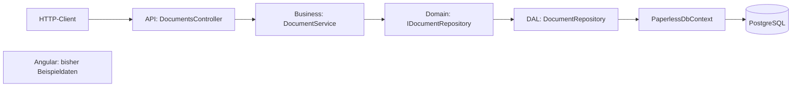

# Paperless

Unser Projekt für SWEN3 ist ein Dokumentenmanagement-System.

## Unser Stand für Sprint 1

Wir haben versucht, REST, Business-Logik, IoC und Mapping umzusetzen.
Bisher geht es um Dokument-Metadaten und Notizen, noch nicht um PDF-Dateiinhalte.
Die DAL und die Registrierung des Repositorys sind inzwischen im Code vorhanden.
Ob alles mit der echten Datenbank zusammenspielt, müssen wir noch gemeinsam prüfen.

## Backend-Tests und Validierung

Die API prüft Eingaben weiterhin mit `[Required]` und `[StringLength]`.
Die Business-Schicht behält die bestehende Textprüfung mit Trim und
`BusinessValidationException` bei. Zusätzlich werden fehlende Commands und
leere Dokument-IDs abgelehnt.

Dokumente und Notizen verwenden dieselben Pflichtfelder und Längengrenzen
auch im Domain-/Datenbankmodell: Titel 200, Dateiname 255, Notiztext 2000 Zeichen.
Der DbContext prüft neue und geänderte Objekte vor jedem Speichern mit
DataAnnotations. Dadurch werden ungültige Daten auch bei direkter DAL-Nutzung
abgelehnt. Datenbankänderungen an bestehenden Tabellen werden nicht automatisch
ausgeführt; die Modellgrenzen gelten beim Neuanlegen der Tabellen. Die Prüfung
vor dem Speichern greift auch bei einer bereits bestehenden Datenbank.

Aktuell bestehen 25 Tests. Vier Tests prüfen erfolgreiche Dokumenterstellung,
Updates mit unveränderter ID und Erstellzeit, Löschen und das Anlegen von Notizen.
Die weiteren Tests prüfen ungültige Eingaben, Grenzwerte,
fehlende Commands, leere IDs, unveränderte Daten nach ungültigen Updates sowie
API-Attribute und DAL-Validierung. Die Business-Tests verwenden ein
Mock-Repository. Die DAL-Tests prüfen ungültige Daten vor dem Datenbankzugriff;
sie sind kein Nachweis für funktionierende PostgreSQL-Persistenz.

**Visual Studio:** Test → Test-Explorer → Alle Tests ausführen.

Oder im Ordner mit `Paperless.sln`:

```powershell
dotnet test Paperless.sln
```

## Anwendung starten

**Mit dem vorhandenen Docker-Setup:** Docker Desktop starten und im Solution-Ordner ausführen:

```powershell
docker compose up --build
```

Danach im Browser [http://localhost:8080/health](http://localhost:8080/health) öffnen.
Dort sollte `ok` stehen. Unter [http://localhost:8080/api/documents](http://localhost:8080/api/documents) werden die Dokumente abgefragt.
`/health` allein prüft noch keine Datenbankverbindung.

**Direkt in Visual Studio:** Rechtsklick auf `Paperless.Api` → Als Startprojekt festlegen.
Das Startprofil `http` auswählen und mit F5 starten.
Dann [http://localhost:5257/health](http://localhost:5257/health) öffnen.

Für Dokument-Anfragen braucht dieser direkte Start PostgreSQL unter `localhost:5432`
mit den Einstellungen aus `appsettings.json`.
Der aktuelle Compose-Datenbankdienst gibt diesen Port nicht an Windows frei.
Deshalb ist ein nur im Compose-Netz laufendes PostgreSQL für diesen lokalen Start nicht ausreichend.

Das Mapping verwendet AutoMapper 15 wie in den Folien. Ein vorhandener Lizenzschlüssel kann über die Umgebungsvariable `AUTOMAPPER_KEY` gesetzt werden.

## Logging

Einfache ILogger-Aufrufe protokollieren API-Aufrufe, geladene Dokumente
und Notizen, erfolgreiches Erstellen/Ändern/Löschen, Datenbankzugriffe und Fehler.
Beim API-Start und beim Beenden werden ebenfalls Meldungen ausgegeben.
Fehlgeschlagene Datenbankzugriffe werden protokolliert und die Exception danach
weitergegeben. Validierungsfehler und fehlende Dokumente werden im bestehenden
BusinessExceptionHandler protokolliert; unerwartete API-Fehler ebenfalls.
IDs und Anzahlen werden ausgegeben, Titel und Notiztexte nicht.
Die Logs erscheinen in der Konsole oder über `docker compose logs -f api`.
Der eingebaute .NET-Logger wird über ILogger<T> im Konstruktor übergeben.
LogInformation meldet normale Abläufe, LogWarning ungültige Eingaben und
LogError Fehler mit Exception. Der Console-Provider gibt die selbst geschriebenen
Meldungen aus; eigene Console.WriteLine-Aufrufe sind dafür nicht nötig.
Die Business-Schicht verwendet das Microsoft-Paket Logging.Abstractions.
Es gibt keine eigene Logger-Klasse, Logdateien oder Archivierung.

## Wie unser Code zusammenarbeitet



Die Pfeile zeigen den Ablauf einer Backend-Anfrage. Das Interface führt selbst
keinen Code aus: über DI bekommt der Service ein `DocumentRepository` dafür.
Die WebUI ist bisher noch nicht an diesen Ablauf angeschlossen.

### Beispiel: ein Dokument erstellen

Bei `POST /api/documents` liest ASP.NET Core das JSON in ein `CreateDocumentDto`.
`[ApiController]` prüft dessen Attribute. Ungültige Eingaben ergeben HTTP 400,
bevor `DocumentsController.Create` aufgerufen wird.

Der Controller übersetzt das DTO mit AutoMapper in ein `CreateDocumentCommand`
und ruft `DocumentService.CreateAsync` auf. Der Service prüft und trimmt die Texte,
vergibt ID und UTC-Erstellzeit und übergibt das Dokument an das Repository.
`Add` merkt es im DbContext vor, `SaveChangesAsync` prüft es und schreibt es in
PostgreSQL. Danach wird das Ergebnis in ein `DocumentDto` übersetzt.
Der Controller antwortet mit HTTP 201 und der URL des neuen Dokuments.
Ein Dateiname ist dabei nur ein Textfeld; eine PDF-Datei wird noch nicht gespeichert.

### Warum wir es so aufgeteilt haben

- **Schichten:** Der Controller kennt HTTP, der Service unsere Regeln und die DAL
  die Datenbank. Die Domain enthält die gemeinsamen Modelle und den Repository-Vertrag.
  Dadurch können wir die Business-Logik mit einem Mock statt PostgreSQL testen.
- **DTOs und Commands:** DTOs legen fest, was über die API hinein- und hinausgeht.
  Commands enthalten die Eingaben für den Service. Bei Create und Update kann der
  Client deshalb keine ID oder Erstellzeit vorgeben. AutoMapper übernimmt die
  Zuordnung der gleich benannten Felder; die Regeln stehen in `MappingConfiguration`.
- **Dependency Injection:** `Program.cs` registriert die Implementierungen.
  ASP.NET Core übergibt sie über die Konstruktoren. `Scoped` bedeutet eine Instanz
  pro Anfrage, nicht bei jedem Methodenaufruf eine neue. Der DbContext gehört
  dadurch zur jeweiligen Anfrage. Die gemeinsame Systemuhr ist ein Singleton.
- **Validierung:** Die API prüft die Anfrage früh. Der Service prüft die Regeln
  nochmals, weil er auch ohne Controller aufgerufen werden kann. Die DAL prüft
  vor dem Speichern die Domain-Attribute und IDs. Das sind verschiedene
  Eintrittsstellen; die Längengrenzen müssen trotzdem zusammenpassen.
- **Updates:** Wir prüfen beide Texte vor dem Ändern des geladenen Objekts.
  Schlägt die zweite Prüfung fehl, bleibt auch der bisherige Titel erhalten.
  ID und Erstellzeit werden beim Update nicht neu vergeben.
- **Fehler:** Der Service wirft eigene Exceptions. `BusinessExceptionHandler`
  macht daraus HTTP 400 bei ungültigen Eingaben und 404 bei fehlenden Dokumenten.
  Dadurch braucht die Business-Schicht keine HTTP-Abhängigkeit.
- **Notizen:** `DocumentId` verbindet die Notiz mit ihrem Dokument. Vor dem Lesen
  oder Anlegen prüfen wir, ob das Dokument existiert. Beim Löschen eines
  Dokuments entfernt die Datenbank durch Cascade auch die zugehörigen Notizen.
- **Async und CancellationToken:** Datenbankaufrufe werden mit `await` abgewartet,
  ohne während der Wartezeit einen Thread zu blockieren. Der Token wird bis zu EF
  weitergegeben, damit eine abgebrochene Anfrage auch die Datenbankoperation
  abbrechen kann. Async allein macht eine Abfrage nicht schneller.

Die Backend-Dateien liegen unter `src/Paperless.REST/`, die Tests unter
`tests/Paperless.UnitTests/`. Der Einstieg ist `Paperless.Api/Program.cs`,
danach sind Controller, Service und Repository die wichtigsten Stellen zum Erklären.
Für Routing und Formulare der WebUI steht der Ablauf in
[der WebUI-README](src/Paperless.WebUI/README.md).

## Was wir bisher daraus gelernt haben

`/health` zeigt, dass die API läuft. Es zeigt noch nicht, dass PostgreSQL
funktioniert, weil das Repository erst für eine Dokument-Anfrage erzeugt wird.
Die Tabellenprüfung im Repository legt Tabellen nur an, wenn noch gar keine
vorhanden sind. Sie ersetzt keine Migrationen und ergänzt auch keine teilweise
fehlenden Tabellen. Für Änderungen an einer bestehenden Datenbank brauchen wir
noch einen geregelten Ablauf.

Die bisherigen Tests prüfen vor allem Business-Regeln und Validierung.
Mit `Setup` legen wir fest, was das Mock-Repository zurückgibt; mit `Verify`
prüfen wir, ob und wie oft gespeichert werden sollte. Ein Mock speichert nicht
in PostgreSQL. Eine feste Testuhr macht die Prüfung der Erstellzeit nachvollziehbar.
Für das Zusammenspiel von HTTP, Mapping, EF und PostgreSQL fehlen noch
Integrationstests. Die WebUI prüfen wir bisher manuell mit den Beispielen aus
ihrer README und mit `npm run build`.

## Arbeit und Repository

Unser [Repository](https://github.com/HauserSoph/SWEN_3_WS2026_Projekt)
enthält den Code und die [Commit-Historie](https://github.com/HauserSoph/SWEN_3_WS2026_Projekt/commits).
Aufgaben und offene Arbeiten stehen in den
[Issues](https://github.com/HauserSoph/SWEN_3_WS2026_Projekt/issues).
Die Historie hält unter anderem Backend-Validierung, Unit-Tests und Korrekturen
am Docker-Build fest. Der aktuelle Stand und die noch offenen Verbindungen
sind oben beschrieben. Neue Entscheidungen und Erfahrungen ergänzen wir hier,
sobald die jeweilige Funktion umgesetzt ist.
